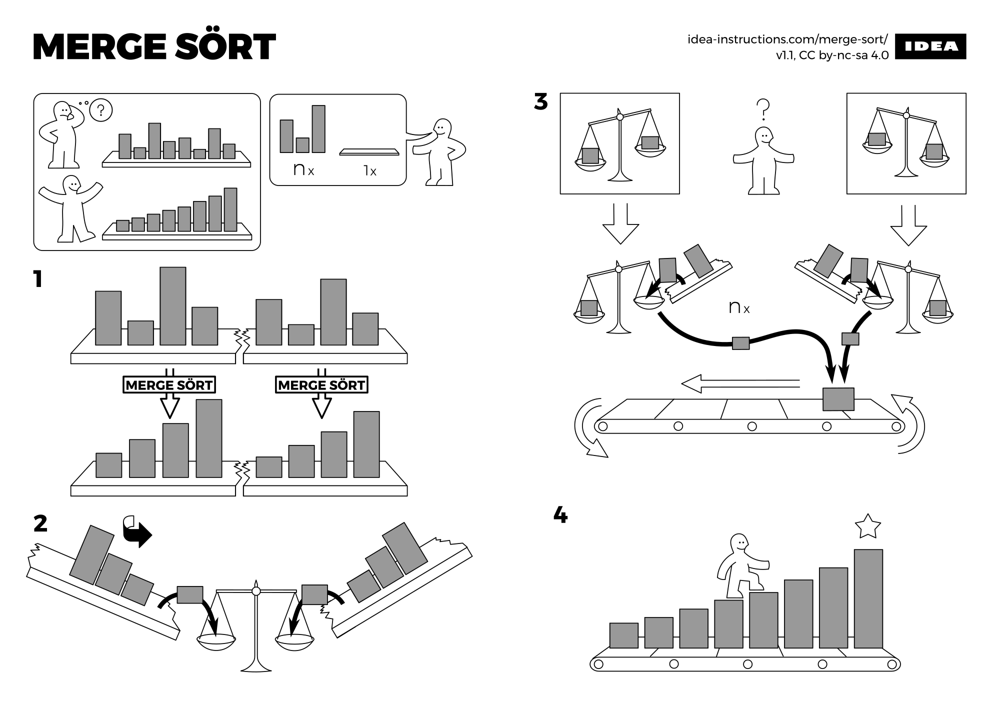
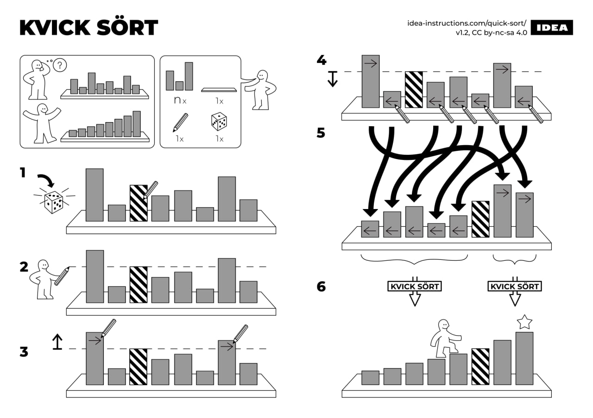

# Applications de la récursivité : tris de tableaux


## Rappels sur les algorithmes de tris vus en classe de première

!!! abstract "Principe du tri par insertion"
	
	Le principe du tri par insertion est le suivant : au moment où on considère un élément du tableau à trier, les éléments qui le précèdent sont déjà triés, tandis que les éléments qui le suivent ne sont pas encore triés. Il faut donc prendre le premier élément de la partie non triée et l'insérer à la bonne place dans la partie triée.
	
	On peut voir sur l'animation suivante extraite de [wikipedia](https://fr.wikipedia.org/wiki/Tri_par_insertion) :
	
	<p align = "center">
	{: style ="width:30%;"}
	</p>
	
	La complexité du tri par insertion est quadratique (en $\mathcal{O}(n^2)$) dans le pire des cas et en moyenne, et linéaire (en $\mathcal{O}(n)$) dans le meilleur des cas (tableau déjà trié ou presque trié). C'est donc un tri dont la vitesse d'exécution dépendra fortement de la situation initiale.
	

	??? quote "Le code en Python"
		``` python linenums="1"
		def tri_insertion(L):
			N = len(L)
			for n in range(1,N):
				cle = L[n]
				j = n-1
				while j>=0 and L[j] > cle:
					L[j+1] = L[j] # decalage
					j = j-1
				L[j+1] = cle
		
		```
	
	
!!! abstract "Principe du tri par sélection"
	
	Sur un tableau de $n$ éléments, le principe du tri par sélection est le suivant : à chaque étape, on **sélectionne** le plus petit élément du tableau, et on le place à la première position du tableau. À l'étape suivante, on ne s'intéresse plus qu'au sous-tableau qui commence après le dernier élément sélectionné.
	
	
	On peut voir sur l'animation suivante extraite de [wikipedia](https://fr.wikipedia.org/wiki/Tri_par_s%C3%A9lection) :
	
	<p align = "center">
	{: style ="width:30%;"}
	</p>
	
	Cet algorithme de tri, simple à comprendre, est considéré comme mauvais car sa complexité en temps est en $\mathcal{O}(n^2)$, que ce soit dans le pire des cas ou bien dans le meilleur des cas (même pour un tableau déjà trié il faudra faire toutes les comparaisons).
	
	??? quote "Le code en Python"
		``` python linenums="1"
		def tri_selection(tab):
			for i in range(len(tab)):
				# Trouver le min du sous-tableau commençant à
				# l'indice i
				indice_min = i
				for j in range(i+1, len(tab)):
					if tab[indice_min] > tab[j]:
						indice_min = j
				# échange de place entre l'élément minimal
				# et l'élément d'indice i
				tmp = tab[i]
				tab[i] = tab[indice_min]
				tab[indice_min] = tmp
		```
		
!!! warning "Tri en place"
	Dans les deux algorithmes, le tri est dit {==**en place**==}, car c'est le tableau original qui est trié. Il n'est pas nécessaire de créer de tableau supplémentaire, ce qui explique l'absence de `return` dans les deux fonctions Python.

## Le tri fusion

<p align ="center">

</p>

!!! abstract "Principe du Tri Fusion (Merge Sort)"
	
	Le principe du {==**tri fusion**==} est de séparer un tableau à trier en **deux sous-tableaux** qu'on triera récursivement (ou itérativement, 
	mais ce ne sera pas le cas dans ce cours) de nouveau par tri fusion.
	
	Une fois les sous-tableaux triés, il faudra {==**fusionner**==} ces deux sous-tableaux en une seule entité.
	
	Cet algorithme est du type {==**diviser pour régner**==} (*Divide and Conquer*) : on sépare la tâche a priori difficile en deux tâches plus simples (ici, il s'agit de diminuer la taille des tableaux). Il a été inventé par {==**John von Neumann en 1945**==}.
		
	<p align="center">
	{: style="width:50%;"}
	</p>


	
	

!!! question "Fonction de fusion"


	La principale difficulté dans cet algorithme est de créer une fonction fusionnant les deux tableaux triés. 
	
	1. Avant de commencer, regardez la vidéo suivante :
	
		

	2. Quels sont les liens entre $i$, $j$ et $k$ ? Quelles conditions ces variables compteurs doivent-elles respecter ?
	3. Quel type de boucle allons-nous utiliser ?
	4. Que se passe-t-il dans la vidéo quand $j$ atteint la valeur $3$ ?
	5. Implémenter une fonction `fusion(t1 : list, t2 : list) -> list` qui prend en argument deux tableaux supposés triés (on ne vérifiera pas), et qui renvoie le tableau trié contenant tous les éléments des deux tableaux `t1` et `t2`.
	
		On pourra utiliser les tests suivants pour vérifier que la fonction est correcte :
		
		??? quote "Les tests"
			``` python
			assert fusion([12,35,45],[4,42,63]) == [4, 12, 35, 42, 45, 63]
			assert fusion([12,35], [57]) == [12, 35, 57]
			assert fusion([12,35], [42,57]) == [12, 35, 42, 57]
			assert fusion([12,35], []) == [12, 35]
			assert fusion([], [12,35]) == [12, 35]
			assert fusion([42,57,67,75], [12,35]) == [12, 35, 42, 57, 67, 75]
			assert fusion([], []) == []
			```
	
	
	
		
!!! question "Tri Fusion Récursif"

	Une fois la fonction `fusion` codée, l'algorithme de tri par fusion est simple :
	
	1. Regardez la vidéo suivante :

		
		
	2. Quel est le cas de base ?
	3. Quel est le cas récursif ?
	4. Implémenter une fonction `tri_fusion(t : list) -> list` qui prend en argument un tableau et renvoie une copie triée de ce tableau.
	

		
!!! question "Complexité en temps"
	

	
	1. Copiez-collez le code ci-dessous permettant d'utiliser le décorateur `@timeit` :
		``` python 
		import time                                                

		def timeit(method):

			def timed(*args, **kw):
				ts = time.time()
				result = method(*args, **kw)
				te = time.time()
				print(f" {method.__name__} ({args},{kw}) {te-ts}" )
				return result

			return timed
		```
		
		!!! warning "Décorateur `@timeit`"
			Pour utiliser le décorateur, on le place dans la ligne précédant la définition
			de la fonction qu'on veut décorer. Par exemple :
			``` python
			@timeit
			def tri_insertion(tab : list) :
				...
			```
			Chaque fois que la fonction `tri_insertion` sera appelée, le décorateur sera appliqué
			et exécutera la fonction `timed`, qui calcule le temps d'exécution de la fonction décorée.
			
			Il faudra être attentif à son utilisation **dans le cas des fonctions récursives !** (Je vous laisse constater par vous-même le problème rencontré)

			!!! tip "Fonction englobante"

				Parfois il est nécessaire d'englober la fonction que l'on souhaite étudier au sein d'une autre fonction. Par exemple, pour éviter un appel à `timeit` à chaque appel récursif, il faut placer le décorateur sur une fonction qui englobera la fonction récursive. Par habitude de programmation, on appellera la fonction englobante du nom de la fonction récursive originale, et on renommera la fonction originale en `compute` :

				``` python
				@timeit
				def tri_fusion(t : list) -> list :
					def compute(t : list) -> list :
						if len(t) == 0 or len(t) == 1:
							return t
						else :
							return fusion(compute(t[:len(t)//2]), compute(t[len(t)//2:]))
					return compute(t)
				```
				Ainsi, le décorateur `timeit` ne s'applique pas à chaque appel récursif, puisque la fonction `tri_fusion` n'est appelée qu'une seule fois.

	
	2. Créer une fonction `genere_list_alea(n : int) -> list[int]` qui crée un tableau de taille $n$ d'entiers aléatoires compris entre $0$ et $n^2$.
	3. Créer à l'aide de toutes les fonctions précédentes une fonction `teste_temps(n : int)` qui compare les temps d'exécution des différents tris. Tester cette fonction pour $n$ valant $100$, $1~000$, $10~000$. 
	
		**Attention**, il faudra effectuer à chaque fois les tests sur le même tableau.
		
		!!! warning "Un risque"
			Les tris par insertion et par sélection sont des tris en place : ils modifient le tableau original. Il faut donc créer une copie du tableau original pour chaque tri avant de l'utiliser (on peut utiliser la fonction `deepcopy` du module `copy`).
		
	
	4. Que peut-on en conclure quant à la complexité en temps du tri fusion ?
	
	
		
!!! info "Complexités du tri fusion"
	La version la plus simple du tri fusion sur les tableaux a une efficacité comparable au tri rapide, mais elle n'opère pas en place : une zone temporaire de données supplémentaire de taille égale à celle de l'entrée est nécessaire (des versions plus complexes peuvent être effectuées en place mais sont moins rapides).
	La complexité en temps est en $\mathcal{O}(n \log(n))$ dans tous les cas et la complexité en espace est en général en $\mathcal{O}(n)$.

	
## Plus vite ! QuickSort ! (Hors programme)

Un autre algorithme de type « diviser pour régner », hors programme, est le QuickSort (tri rapide), dont le détail est présenté ci-dessous. En pratique, il est souvent plus rapide que le tri fusion, même si sa complexité dans le pire des cas est quadratique. Il est utilisé par de nombreuses bibliothèques standard (en C, C++, Java pour les types primitifs...). En revanche, la fonction native `sorted` et la méthode `sort` des listes en Python utilisent un autre algorithme, le *Timsort*, qui est un hybride entre le tri fusion et le tri par insertion.

!!! abstract "Principe du QuickSort"
	
	<p align="center">
	{: style="width:50%;"}
	</p>

	??? quote "Le code en Python"
		``` python linenums="1"
		def tri_rapide(t : list) -> list :
			if len(t) <= 1:
				return t
			else :
				pivot = t[0]
				plus_petits = [x for x in t[1:] if x < pivot]
				plus_grands = [x for x in t[1:] if x >= pivot]
				return tri_rapide(plus_petits) + [pivot] + tri_rapide(plus_grands)
		```

	??? quote "Version en place : partition de Lomuto"
		Le pivot est le dernier élément de la zone à trier. On parcourt la zone en rangeant à gauche tous les éléments strictement plus petits que le pivot, puis on place le pivot juste après eux : il est alors à sa place définitive.

		``` python linenums="1"
		def partition_lomuto(t : list, debut : int, fin : int) -> int :
			pivot = t[fin]
			i = debut
			for j in range(debut, fin):
				if t[j] < pivot:
					t[i], t[j] = t[j], t[i]
					i = i + 1
			t[i], t[fin] = t[fin], t[i]
			return i

		def tri_rapide_lomuto(t : list) -> None :
			def compute(debut : int, fin : int) -> None :
				if debut < fin:
					p = partition_lomuto(t, debut, fin)
					compute(debut, p - 1)
					compute(p + 1, fin)
			compute(0, len(t) - 1)
		```

	??? quote "Version en place : partition de Hoare"
		Le pivot est le premier élément de la zone à trier. Deux indices partent des deux extrémités et se rapprochent : dès que l'indice de gauche trouve un élément trop grand et celui de droite un élément trop petit, on les échange. Le pivot n'est pas forcément à sa place définitive à la fin de la partition, d'où les appels récursifs sur `debut..p` et `p+1..fin`.

		``` python linenums="1"
		def partition_hoare(t : list, debut : int, fin : int) -> int :
			pivot = t[debut]
			i = debut - 1
			j = fin + 1
			while True:
				i = i + 1
				while t[i] < pivot:
					i = i + 1
				j = j - 1
				while t[j] > pivot:
					j = j - 1
				if i >= j:
					return j
				t[i], t[j] = t[j], t[i]

		def tri_rapide_hoare(t : list) -> None :
			def compute(debut : int, fin : int) -> None :
				if debut < fin:
					p = partition_hoare(t, debut, fin)
					compute(debut, p)
					compute(p + 1, fin)
			compute(0, len(t) - 1)
		```

